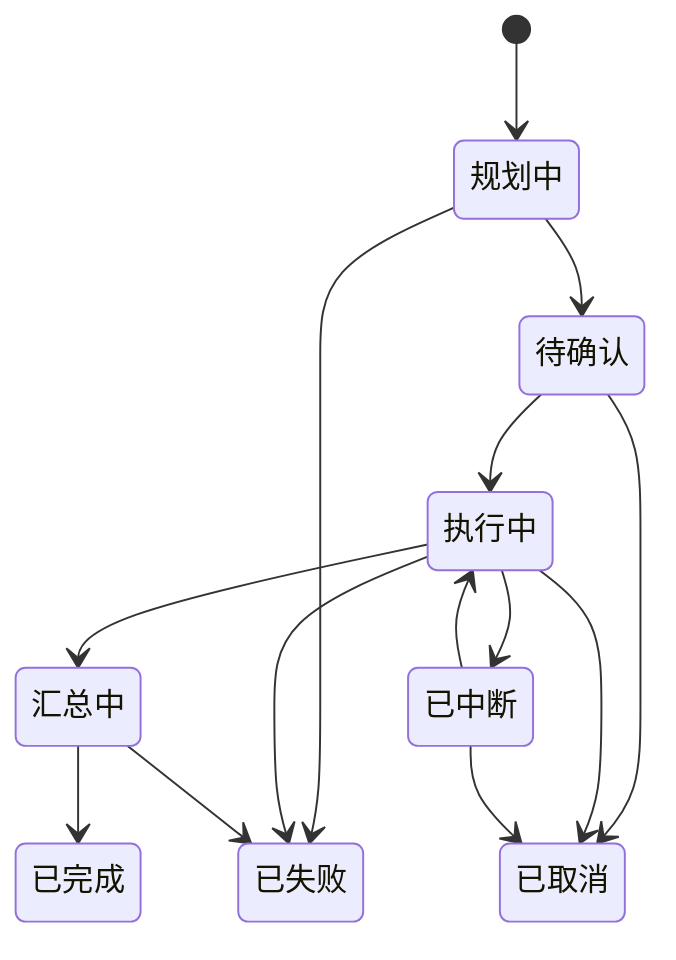
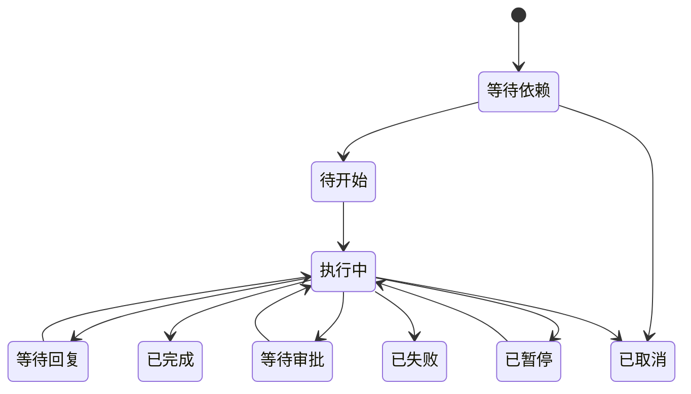

# Bowknot Agent 桌面端产品需求文档

| 项 | 内容 |
| --- | --- |
| 文档版本 | v0.2 |
| 状态 | 评审中 |
| 更新日期 | 2026-10-29 |
| 产品代号 | Bowknot Agent |
| 文档范围 | 产品需求；不含详细技术设计、接口定义与数据表结构 |

> 标记约定：`[TBD]` 表示尚未确定、需要决策的项；`[Assumption, TBD]` 表示当前按假设推进、后续需要确认；优先级 P0 > P1 > P2。

## 1. 背景与目标

### 1.1 背景

用户需要在同一个桌面工作空间中完成三类事情：使用第三方 Web 应用、让 AI 助手持续处理任务、生成图片/视频/语音。当前这些能力分散在不同网页与工具里，缺少统一入口、统一的模型配置和统一的任务视图。

### 1.2 产品定位

Bowknot Agent 是一个本地优先的桌面 AI 工作台，由六部分组成：应用商店与 WebApp 容器、助手与多 Agent 系统、群聊协作、创作工具、声明式插件系统、本地 AI 网关。所有 AI 能力通过可配置的 API 提供，由本地 AI 网关统一调度。

### 1.3 目标

- 用户可以在一个入口安装并启动 WebApp，且应用获得与其他应用一致的能力集。
- 用户可以在助手中向主 Agent 下达目标，由主 Agent 自动判断是否调用子 Agent，并看到计划、执行与汇总。
- 用户可以在群聊中与主 Agent 沟通，由主 Agent 派发任务给多个子 Agent；子 Agent 之间可以同步进展、等待依赖，最终各自汇报并由主 Agent 汇总。
- 用户可以创建多个 Agent，每个 Agent 拥有独立的人设、用户信息、会话、记忆与插件启用清单。
- 用户可以通过声明式插件为 Agent 扩展技能与工具能力，并从本地导入插件。
- 用户可以在同一界面生成图片、视频和语音，并在素材库中找回历史结果。
- 更换模型供应商只需修改配置，不需要改变产品流程。

### 1.4 本次范围调整（v0.2）

- 助手与 Agent 拆分：助手只服务主 Agent；子 Agent 管理与 1:1 对话移入 Agent 模块。
- 新增群聊模块：主 Agent 为群主，子 Agent 为成员，支持依赖等待、群内进展同步、各自汇报与主 Agent 汇总。
- 插件从暂缓提前为首版能力：只支持声明式插件与本地导入，不执行任意代码；插件市场、可执行插件与 MCP 延后。
- 桌宠首版只做显示/隐藏与入口，语音对话、TTS/STT 延后。
- 长期记忆改为每个 Agent 独立，按周文件存储，并由每次对话的日期检测触发汇总。
- Agent 工作区目录化：每个 Agent 拥有独立的 `AGENTS.md`、`PERSONA.md`、`USER.md`、会话、记忆与插件启用清单。

## 2. 用户与核心场景

### 2.1 目标用户

单人本地用户，典型画像为开发者、创作者或重度 AI 使用者。

[Assumption, TBD] 产品为单机单用户，数据默认保存在本地，不提供账号体系与云同步。

### 2.2 核心场景

| 场景 | 入口 | 完成条件 |
| --- | --- | --- |
| S1 安装并使用远程 WebApp | 应用商店 | 应用在独立窗口正常运行，并获得与其他应用一致的能力集 |
| S2 主 Agent 完成多步任务 | 助手 | 用户看到计划、派发、执行与最终汇总 |
| S3 多 Agent 群聊协作 | 群聊 | 用户看到主 Agent 派发、子 Agent 进展与依赖等待、各自汇报与最终汇总 |
| S4 通过桌宠与主 Agent 交互 | 桌宠窗口 / 助手 | 桌宠可显示与隐藏，点击进入助手；首版不含语音 |
| S5 生成并管理素材 | 创作 | 生成结果成功落库，可在素材库检索与复用 |
| S6 配置模型供应商 | 设置 | 连接测试通过，对应能力可正常调用 |
| S7 创建 Agent 并扩展插件 | Agent / 插件 | Agent 拥有独立工作区，启用插件后获得对应技能与工具 |

## 3. 范围与优先级

- **P0**：首个可用版本必须完成的最小闭环，缺一项则该模块不可用。
- **P1**：核心闭环可用后补齐的增强能力。
- **P2**：明确暂缓，不进入当前版本范围。

| 模块 | P0 | P1 | P2 / 暂缓 |
| --- | --- | --- | --- |
| 桌面壳 | 主界面、模块导航（应用 / 助手 / Agent / 群聊 / 任务 / 插件 / 创作 / 设置）、应用独立窗口、托盘 | 全局唤起、命令面板、通知、自启动 | — |
| App Store | 商店浏览、远程/本地安装、启动、卸载、开发者验证环境 | 更新、远程 URL 应用、应用管理 | — |
| 助手 | 主 Agent 会话、自动派发、计划确认、汇报汇总、桌宠开关 | 运行追踪与断点重试 | — |
| Agent | 主 Agent 固定、子 Agent CRUD、独立工作区、1:1 对话、插件选择、删除确认 | 创建时从主 Agent 复制模板 | — |
| 群聊 | 群 CRUD、计划确认、依赖调度、群内消息、汇报汇总、取消 | 协作视图增强 | 自由讨论模式 |
| 桌宠 | 窗口、占位形象、显示/隐藏同步、点击跳转 | 独立气泡、空闲行为 | 语音对话、TTS/STT、写实形象 |
| 长期记忆 | 每 Agent 独立、周文件、summary.json、日期触发、检索与管理 | 冲突处理 | — |
| 创作 | 图片生成、语音合成、任务队列、素材库 | 视频生成、费用预估 | — |
| 插件 | 本地导入、清单校验、声明式技能、内置工具、每 Agent 启用 | 更新与回滚 | 插件市场、可执行插件、MCP |
| AI 网关 | 供应商配置、能力路由、密钥安全、用量记录 | 预算与告警 | — |
| 任务中心 | 统一列表（含助手 Run 与群聊 Run）、详情、取消/重试、持久化 | 通知联动 | — |
| 隐私与数据 | 审计、数据管理 | — | — |
| 授权与订阅 | 月度/年度授权、激活、到期降级、设备绑定 | 许可证门户、自动续费 | 买断制 |

## 4. 产品模型

### 4.1 角色与职责

| 角色 | 职责 | 边界 |
| --- | --- | --- |
| 本地用户 | 唯一的操作者与付费主体 | 拥有全部数据 |
| 主 Agent | 助手页唯一入口；理解目标、拆解任务、派发、汇总；群聊群主 | 仅一个，不可删除；不得绕过用户确认执行高风险操作 |
| 子 Agent | 执行 Run 内任务；在群内同步进展、请求协作并提交汇报；可 1:1 对话 | 不直接向用户下发结论；不得改变任务目标；不得自行创建跨 Run 任务；不得删除其他 Agent |
| 群聊 | 长期协作容器 | 成员必须为已启用的子 Agent；群主固定为主 Agent |
| 插件 | 为 Agent 提供模型之外的技能与工具能力 | 声明式能力包，只能组合内置工具，不执行任意代码 |
| WebApp | 第三方或本地网页应用 | 运行在受限容器内，使用平台统一提供的能力集 |
| AI 网关 | 唯一的模型 API 调用出口 | 不暴露给 WebApp 与渲染界面直接访问密钥 |

### 4.2 核心对象

| 对象 | 定义 | 关键属性 |
| --- | --- | --- |
| Agent | 可配置的智能体 | ID、名称、头像、人设、模型、启用插件、启用状态、工作区路径 |
| Agent 工作区 | Agent 的本地目录 | `AGENTS.md`、`PERSONA.md`、`USER.md`、`sessions/`、`memories/`、`plugins.json` |
| 会话 | 一次 1:1 对话 | ID、Agent ID、标题、消息、模型、时间 |
| 群聊 | 长期协作容器 | ID、名称、群主、成员、创建时间 |
| 运行 Run | 群聊或助手会话内的一次协作 | ID、目标、计划、状态、预算、汇总、归属 |
| 任务 Task | Run 内最小执行单元 | ID、目标、执行者、依赖、状态、汇报、消耗 |
| 群消息 | 群内一次协作通信 | ID、Run ID、Task ID、发送方、类型、内容、时间 |
| 汇报 | 子 Agent 返回的结构化结果 | 结论、产出物、未解决问题、过程摘要、消耗 |
| 记忆周文件 | 一周的记忆正文 | 周起止、内容、来源 |
| 记忆索引 | `summary.json` | 周列表、每周摘要、文件引用、更新时间 |
| 插件 | 声明式能力包 | ID、名称、版本、清单、技能、所需工具、校验和 |
| 应用清单 | WebApp 的安装与运行描述 | 应用 ID、名称、版本、入口、窗口参数 |
| 统一能力集 | 所有 WebApp 可获得的一组系统能力 | 能力项、调用边界、错误码 |
| 生成任务 | 一次图片/视频/语音生成 | 参数、模型、状态、费用、结果文件 |
| 素材 | 已生成的可用文件 | 类型、参数、模型、来源任务、收藏状态 |
| 供应商配置 | 一个模型服务商的接入信息 | 名称、地址、密钥、可用模型 |

### 4.3 关键状态

运行 Run 状态：



任务 Task 状态：



- 终态为已完成、已取消；已失败可重试，重试生成新任务并关联原任务。
- 应用重启后，执行中的 Run 必须恢复为「已中断」，由用户决定继续或终止。
- 群消息类型固定为：`progress`（进展）、`request`（请求）、`response`（答复）、`handoff`（交接）、`blocked`（阻塞）、`report`（汇报）。
- 应用状态：未安装、安装中、已安装、运行中、更新中、已禁用、损坏。

## 5. 功能需求

### 5.1 桌面壳与全局交互

主界面由左侧模块导航（应用、助手、Agent、群聊、任务、插件、创作、设置）、左侧导航栏底部常驻的全局状态（网关状态、当前模型、用量入口）和主内容区组成。任务中心可从任意模块打开。

| ID | 需求 | 行为与规则 | 异常与边界 | 优先级 |
| --- | --- | --- | --- | --- |
| FR-SHELL-01 | 主界面结构 | 切换模块时保留各模块上次状态；左侧导航栏底部常驻网关在线/离线状态 | 网关离线时，依赖模型的功能禁用并说明原因；浏览历史、查看记忆、编辑配置、导入插件仍可用 | P0 |
| FR-SHELL-02 | 应用独立窗口 | WebApp 默认在新窗口打开；记忆窗口尺寸与位置；主窗口单实例 | 窗口恢复失败时回到默认布局 | P0 |
| FR-SHELL-03 | 托盘与退出 | 托盘菜单提供打开主界面、显示/隐藏桌宠、退出；关闭主窗口默认隐藏到托盘、不退出进程，从托盘退出才结束进程 | 有运行中 Run 时退出需提示并确认 | P0 |
| FR-SHELL-04 | 全局唤起 | 全局快捷键 [TBD] 唤起助手输入框；命令面板可搜索应用、Agent、群聊、任务与生成入口 | 快捷键冲突时提示并允许修改 | P1 |
| FR-SHELL-05 | 通知 | Run 完成、失败、待确认、生成完成时通知，可跳转到对应详情 | 支持免打扰时段 | P1 |
| FR-SHELL-06 | 自启动 | 默认关闭，用户可开启 | 开启失败需说明系统限制 | P1 |

### 5.2 App Store 与 WebApp 容器

商店以列表 + 详情的方式呈现应用；WebApp 运行在独立窗口与独立会话中，通过统一能力桥访问系统能力。所有 WebApp 获得同一能力集，不做按应用的能力授权。能力接口由宿主注入，WebApp 直接调用，不提供独立 SDK 包。

| ID | 需求 | 行为与规则 | 异常与边界 | 优先级 |
| --- | --- | --- | --- | --- |
| FR-APP-01 | 商店浏览 | 支持分类、搜索、查看详情（名称、图标、版本、大小、来源、更新说明）；显示未安装/已安装/可更新 | 商店源不可达时展示本地已安装列表与重试入口 | P0 |
| FR-APP-02 | 远程安装 | 下载 → 校验完整性与签名 → 安装 → 标记已安装 | 下载失败、校验失败、磁盘不足时保持未安装并给出原因；取消安装清理临时文件 | P0 |
| FR-APP-03 | 本地安装 | 选择本地安装包（`.bkapp`，未压缩 tar）或应用目录 → 校验清单与版本兼容性 → 安装 | 清单缺失、版本不兼容、应用 ID 冲突时拒绝并说明 | P0 |
| FR-APP-04 | 应用清单 | 安装包为未压缩 tar、后缀 `.bkapp`，`manifest.json` 位于包根；schema 1 字段：`id`（小写字母开头、2–64 位小写字母/数字/连字符）、`name`（1–64 字符）、`version` 与 `min_shell_version`（`x.y.z`）、`entry`（包内 `.html`）、`icon`（包内 `.svg/.png/.jpg/.jpeg/.webp`，≤1 MiB）、`summary`（1–200 字符）、`category`（`efficiency`/`creation`/`developer`）、`release_notes`（≤500 字符）、`window`（`width`/`height`/`min_width`/`min_height`，缺省 1080×720、最小 640×480） | 清单字段缺失或格式非法、`min_shell_version` 高于当前壳版本、包内含符号链接/硬链接/设备/绝对路径/`..` 时拒绝安装；解压后总体积 ≤200 MiB、单文件 ≤64 MiB、条目 ≤2000 | P0 |
| FR-APP-05 | 启动与隔离 | 新窗口加载应用；独立会话隔离；注入统一能力接口；能力调用失败返回结构化错误 | 加载超时或崩溃时显示错误页，可重新加载；连续崩溃 [TBD] 次后提示禁用 | P0 |
| FR-APP-06 | 统一能力集 | 所有应用均获得：应用私有目录读写、用户显式选择文件/目录的受限读写、剪贴板、系统通知、打开外部链接 | 不提供原始文件系统访问；路径必须限制在允许的根目录内 | P0 |
| FR-APP-07 | 卸载 | 确认 → 关闭窗口 → 询问保留或删除应用数据 → 移除程序 | 保留的数据在数据管理中可见并可后续删除 | P0 |
| FR-APP-08 | 崩溃隔离 | 单个 WebApp 崩溃不影响壳与其他应用 | 崩溃计数与禁用策略 [TBD] | P0 |
| FR-APP-09 | 更新 | 启动时或手动检查更新；应用运行中不强制更新；更新失败回滚旧版本 | 需应用关闭后才能替换文件时给出明确提示 | P1 |
| FR-APP-10 | 远程 URL 应用 | 直接加载远程地址时显示域名；与其他应用获得同一能力集 [Assumption, TBD] | 地址不可达或证书异常时展示错误页，不提供跳过选项 | P1 |
| FR-APP-11 | 应用管理 | 已安装列表、启用/禁用、查看数据占用、打开数据目录 | 禁用后不删除数据 | P1 |
| FR-APP-12 | 开发者验证环境 | 主应用内提供开发者模式，默认关闭：加载本地应用目录、文件变更自动重载、打开 DevTools、注入真实能力、展示能力调用日志 | 本地目录必须包含合法清单；应用 ID 与已安装应用冲突时拒绝加载；开发应用使用独立数据空间并带明确标识；关闭开发者模式后不再运行本地目录应用 | P0 |

### 5.3 助手（主 Agent）

助手模块只服务主 Agent，是用户与主 Agent 沟通的唯一入口。页面由会话列表、消息流与任务卡片组成，不展示子 Agent 列表，也不提供子 Agent 直聊入口。主 Agent 自动判断是否需要调用子 Agent，派发仍需要用户确认。

| ID | 需求 | 行为与规则 | 异常与边界 | 优先级 |
| --- | --- | --- | --- | --- |
| FR-AGT-01 | 主 Agent 唯一性 | 系统内仅一个主 Agent，固定工作区 `agents/main`，不可删除；可编辑名称、人设、模型与启用插件 | 子 Agent 不能替代主 Agent 接收用户任务；主 Agent 无可用模型时助手禁用并说明 | P0 |
| FR-AGT-02 | 助手会话 | 流式输出；新建、重命名、删除会话；支持中止与重新生成；会话文件位于 `agents/main/sessions/` | 模型失败时按备用顺序重试；网络中断保留已生成内容并可继续 | P0 |
| FR-AGT-03 | 自动派发与确认 | 主 Agent 通过 `delegate` 工具判断是否调用已启用的子 Agent，生成 Run 并归属当前助手会话；计划包含任务、执行者、依赖、完成标准与预算；展示计划卡片，用户确认后执行 | 不需要派发时直接回答；无可用子 Agent、模型不可用或依赖成环时拒绝派发并说明；不提供手动「任务模式」开关 | P0 |
| FR-AGT-04 | 汇报与汇总 | 子 Agent 提交结构化汇报（结论、产出物、未解决问题、过程摘要、消耗）；主 Agent 汇总后向用户输出 | 子 Agent 失败时必须说明失败原因与影响；汇报无法结构化时按纯文本结论收录并标注 | P0 |
| FR-AGT-05 | 运行限制 | 单 Run 任务数、并发数、单任务步数、等待超时与 token 预算可限制，默认值见 FR-GRP-07 | 触达任一限制时暂停并请求用户决定继续或终止 | P0 |
| FR-AGT-06 | 高风险审批 | 写文件、删除、对外发送、付费或调用高成本模型、安装插件需用户确认 | 未批准时不执行；审批超时按拒绝处理；Agent 收到拒绝并调整方案 | P0 |
| FR-AGT-07 | 取消与恢复 | 用户可暂停或取消 Run；取消后保留已产生的产出物与费用记录；重启后执行中的 Run 标记为已中断 | 已中断的 Run 由用户决定继续或终止；终态 Run 不再变更 | P0 |
| FR-AGT-08 | 运行追踪 | 每次 Run 可查看步骤、工具调用、耗时、费用与错误 | 支持从失败步骤重试 | P1 |
| FR-AGT-09 | 桌宠开关 | 助手页提供桌宠显示/隐藏开关，与托盘菜单共用同一状态，状态持久化 | 桌宠窗口不可用时开关保持并提示原因 | P0 |

### 5.4 Agent 管理

Agent 模块管理主 Agent 与全部子 Agent。主 Agent 置顶展示、可编辑但不可删除；每个子 Agent 拥有独立工作区与 1:1 会话。

| ID | 需求 | 行为与规则 | 异常与边界 | 优先级 |
| --- | --- | --- | --- | --- |
| FR-AGT-10 | 主 Agent 置顶 | Agent 页首行固定为主 Agent，展示名称、人设摘要、模型与启用插件；进入编辑不提供删除操作 | 主 Agent 工作区缺失时按默认模板重建并提示 | P0 |
| FR-AGT-11 | 子 Agent 创建与编辑 | 字段包含名称、头像、人设、模型、启用插件与启用状态；创建后可直接 1:1 对话 | 名称为空或超长、人设超长、模型不可用时拒绝保存并说明 | P0 |
| FR-AGT-12 | 独立工作区 | 每个 Agent 使用 `agents/<id>/`，包含 `AGENTS.md`、`PERSONA.md`、`USER.md`、`sessions/`、`memories/`、`plugins.json`；`AGENTS.md` 作为入口按固定顺序装配系统提示 | 目录缺失时自动创建默认文件；文件损坏时保留原文件并提示，不静默清空 | P0 |
| FR-AGT-13 | 1:1 对话 | 会话按 Agent 隔离，使用该 Agent 的模型、人设与插件；支持流式、中止与重新生成；不产生群消息 | 子 Agent 不能派发任务、不能创建其他 Agent；模型不可用时禁用输入并说明 | P0 |
| FR-AGT-14 | 插件选择 | 为每个 Agent 启用或停用插件，变更在下一轮对话生效；停用后相关工具调用立即失效 | 插件缺失或校验失败时提示重新导入，并从启用清单移除 | P0 |
| FR-AGT-15 | 删除 Agent | 删除前二次确认，提示将终止其运行中任务、删除其会话、记忆、`USER.md`、`PERSONA.md` 与工作区，并从群聊历史中移除其消息；用户确认后直接删除 | 用户取消则不做任何变更；删除后历史任务保留名称快照 | P0 |
| FR-AGT-16 | 停用 Agent | 停用后不再接收新任务与新群派发；运行中任务继续完成，用户可手动取消 | 停用不影响历史会话与记忆的查看 | P0 |
| FR-AGT-17 | 上限与唯一名 | 子 Agent 上限 20 个；名称不区分大小写唯一；ID 不可变 | 超出上限或重名时拒绝创建并说明 | P0 |
| FR-AGT-18 | 创建模板 | 创建子 Agent 时可选择从主 Agent 复制 `USER.md`、`PERSONA.md` 作为初始模板 | 复制后立即独立，后续修改互不影响 | P1 |

Agent 的 `AGENTS.md` 装配顺序固定为：

```text
AGENTS.md → PERSONA.md → USER.md → memories/summary.json + 相关周记忆 → 已启用插件的 skills/*.md
```

### 5.5 群聊协作

群聊是长期协作容器，运行 Run 是其中的一次协作。群内所有消息对用户与全部成员可见，子 Agent 可以同步进展、请求协作、等待依赖，最后各自汇报，由主 Agent 汇总。

| ID | 需求 | 行为与规则 | 异常与边界 | 优先级 |
| --- | --- | --- | --- | --- |
| FR-GRP-01 | 群创建与管理 | 创建群时填写名称并从已启用子 Agent 中拉取成员；群主固定为主 Agent；支持编辑名称与成员、删除群 | 成员不是已启用子 Agent、超过成员上限时拒绝；删除群需二次确认 | P0 |
| FR-GRP-02 | 群消息 | 群消息对用户与全部成员可见，类型包含进展、请求、答复、交接、阻塞与汇报；按 Run 持久化到消息文件 | 不提供成员间私聊旁路；消息写入失败时保留内存消息并提示 | P0 |
| FR-GRP-03 | Run 生命周期 | 用户发送目标 → 主 Agent 规划任务、依赖、执行者与预算 → 群内展示计划卡片 → 用户确认后执行 → 全部任务终态后汇总 | 用户放弃时取消 Run；依赖成环、任务超限或成员不可用时拒绝执行并说明 | P0 |
| FR-GRP-04 | 依赖调度 | 按任务依赖图调度；只有依赖全部完成的任务进入就绪队列；受并发上限约束；等待必须有超时 | 检测到环时拒绝规划；等待超时任务失败并回报主 Agent；不得静默丢弃任务 | P0 |
| FR-GRP-05 | 子 Agent 协作 | 子 Agent 可广播进展、向指定成员发起请求、等待答复、交接产物或上报阻塞；主 Agent 能看到全部消息 | 子 Agent 不得改变目标、自行创建任务或取消其他任务；跨 Run 通信禁止；请求超时必须返回或失败 | P0 |
| FR-GRP-06 | 汇报与汇总 | 每个子 Agent 完成后提交自己的结构化汇报；主 Agent 在所有任务终态后汇总并向用户汇报 | 失败任务必须说明原因与影响；汇报无法结构化时按纯文本收录并标注 | P0 |
| FR-GRP-07 | 运行限制 | 默认：群成员 ≤ 8、单 Run 任务 ≤ 12、并发 ≤ 3、单 Run 消息 ≤ 200、等待超时 120s、单任务步数 ≤ 20；token 预算 [TBD] | 默认值先硬编码，后续可配置；触达限制时暂停并请求用户决定 | P0 |
| FR-GRP-08 | 运行中干预 | 运行中用户可继续发言；计划锁定，用户可取消整个 Run 或单个任务；主 Agent 可回答问题、重派任务 | 用户不能直接编辑任务；取消后子 Agent 收到终止信号并回报 | P0 |
| FR-GRP-09 | 成员变更 | 仅允许在两次 Run 之间增删成员；停用成员不再接收新任务；删除 Agent 时按 FR-AGT-15 处理 | 运行中增删成员需等待当前 Run 结束；删除 Agent 需用户确认 | P0 |
| FR-GRP-10 | 删除群 | 二次确认后取消运行中 Run，删除群定义与群消息 | 任务中心的 Run 与任务记录保留并标记「群聊已删除」，便于审计 | P0 |
| FR-GRP-11 | 任务中心联动 | 群 Run 与其中任务进入全局任务中心，可查看计划、依赖、状态与汇报 | 群消息只在群聊页展示；任务中心提供跳转到对应群与 Run | P0 |

### 5.6 桌宠

桌宠是主 Agent 的常驻轻量入口。首版只验证窗口、显示/隐藏与入口，不包含语音与 TTS。

| ID | 需求 | 行为与规则 | 异常与边界 | 优先级 |
| --- | --- | --- | --- | --- |
| FR-PET-01 | 窗口 | 透明、置顶、可拖动、可隐藏；提供点击穿透开关；记忆位置与大小 | 多显示器与分辨率变化 [TBD] | P0 |
| FR-PET-02 | 占位形态 | 首版使用占位形象；正式视觉形态 [TBD] | 形象资源缺失时显示占位图，不阻塞功能 | P0 |
| FR-PET-03 | 显示与隐藏 | 助手页开关与托盘菜单共用状态；默认隐藏；状态持久化，重启后恢复 | 桌宠窗口创建失败时保持开关并提示原因 | P0 |
| FR-PET-04 | 基础交互 | 点击桌宠打开助手模块并聚焦主 Agent 会话；首版不提供独立聊天气泡 | 助手不可用时提示配置网关，不进入无限等待 | P0 |
| FR-PET-05 | 人设一致性 | 桌宠与主 Agent 共用 `PERSONA.md`、`USER.md` 与记忆；称呼与语气一致 | 用户修改人设后在下一次回复生效 | P0 |
| FR-PET-06 | 隐私边界 | 首版不录音、不常驻监听 | 后续语音能力必须提供录音指示与一键关闭 | P0 |
| FR-PET-07 | 语音对话 | 按键说话、STT/TTS、字幕与语速音量配置；全局快捷键与权限 [TBD] | 识别或合成失败时降级为文字并提示 | P2 |
| FR-PET-08 | 空闲与打扰 | 空闲时低帧率待机；全屏应用或会议时自动静音或隐藏 [Assumption, TBD]；支持免打扰时段 | 用户手动隐藏后不自动弹出 | P1 |

### 5.7 长期记忆

每个 Agent 拥有独立记忆，不自动共享。记忆按周文件存储，`summary.json` 作为索引。每次对话开始时自动检查当前日期，触发周文件创建与上一周摘要生成。

| ID | 需求 | 行为与规则 | 异常与边界 | 优先级 |
| --- | --- | --- | --- | --- |
| FR-MEM-01 | 独立范围 | 记忆与 `USER.md` 均按 Agent 独立；主 Agent 与子 Agent 之间不自动共享 | 需要跨 Agent 上下文时由主 Agent 在任务输入中显式传递 | P0 |
| FR-MEM-02 | 存储结构 | 每周一个 `memories/YYYY-MM-DD_YYYY-MM-DD.md`，`memories/summary.json` 记录周列表、每周摘要、文件引用与更新时间 | 目录或文件缺失时自动创建；损坏文件保留原文件并提示 | P0 |
| FR-MEM-03 | 写入触发 | 由系统自动触发，无需用户手动操作：每次对话（助手会话、Agent 1:1、群聊 Run）开始前检查当前日期；进入新一周时先生成上一周摘要并写入 `summary.json`，再创建当周文件；当周文件不存在时创建 | 摘要生成失败不阻塞对话，标记待重试，下次日期检查时重试；用户仍可手动编辑或删除记忆 | P0 |
| FR-MEM-04 | 写入内容 | 用户明确要求记住、用户纠正、任务结论、稳定偏好可写入；闲聊默认不写入；低置信度信息不得作为事实写入 | 写入前如涉及敏感信息需提示 [TBD] | P0 |
| FR-MEM-05 | 检索 | 对话按语义与时间检索当前 Agent 的记忆与索引；引用时在界面标注来源 | 无相关记忆时不编造，明确表示未找到；供应商不支持语义检索时降级为关键词 | P0 |
| FR-MEM-06 | 管理 | 按 Agent 查看、编辑、删除与搜索记忆；删除需二次确认 | 删除后不可恢复 | P0 |
| FR-MEM-07 | 导出与清除 | 按 Agent 导出为可读文件；清除该 Agent 全部记忆需二次确认 | 清除后不可恢复 | P0 |
| FR-MEM-08 | 隐私 | 默认本地存储；生成 embedding 时仅传输必要文本；供应商与用途在隐私中心可见 | 供应商不支持时降级为关键词检索 | P0 |
| FR-MEM-09 | 冲突处理 | 同一主题多版本时保留最新版本并标注被替代内容；用户可手动选择生效版本 | 用户纠正优先于系统推断 | P1 |
| FR-MEM-10 | 摘要生成 | 跨周时调用网关模型生成上一周摘要；摘要只保留精简结论、偏好与未完成事项 | 模型不可用时保留周文件并标记摘要待生成；不得丢失原始记忆 | P0 |
| FR-MEM-11 | 上下文预算 | 注入 `summary.json` 与相关周记忆摘要，不注入整周全文；超出预算时截断并标注 | 截断不得丢弃用户明确要求记住的内容 | P0 |

### 5.8 创作模块

创作模块分为图片、视频、语音三个标签，每个标签包含参数区与结果区，生成任务统一进入任务中心。

| ID | 需求 | 行为与规则 | 异常与边界 | 优先级 |
| --- | --- | --- | --- | --- |
| FR-CRE-01 | 图片生成 | 输入提示词、反向提示词（模型支持时）、尺寸、数量、模型；提交后进入队列并展示进度 | 参数超出模型能力时禁用并说明 | P0 |
| FR-CRE-02 | 语音合成 | 输入文本，选择音色、语速、音量、格式；支持试听与保存到素材库 | 长文本分段策略 [TBD]；超长文本需提示 | P0 |
| FR-CRE-03 | 生成任务 | 状态与任务中心一致；支持取消与重试；重启后状态可恢复 | 重试不得重复计费，需网关幂等支持 [TBD] | P0 |
| FR-CRE-04 | 素材库 | 记录参数、模型、时间、费用、来源任务；支持收藏、删除、打开文件位置、按类型筛选 | 存储配额与清理策略 [TBD]；删除不可恢复需确认 | P0 |
| FR-CRE-05 | 失败处理 | 区分供应商错误、内容审核拒绝、超时、配额不足，并给出明确原因 | 内容审核拒绝不自动重试 | P0 |
| FR-CRE-06 | 视频生成 | 文生视频、图生视频；时长、分辨率、帧率受模型约束；展示进度与预估等待 [TBD] | 长任务中断后保留参数，可重新提交 | P1 |
| FR-CRE-07 | 费用提示 | 提交前显示预估费用；超过单次阈值需确认，阈值 [TBD] | 无法预估时提示可能产生费用 | P1 |
| FR-CRE-08 | 能力适配 | 根据所选模型动态启用或禁用参数；不支持的参数不提交 | 未配置对应能力时隐藏入口并引导配置 | P0 |

### 5.9 插件

插件为 Agent 提供模型之外的技能与工具能力。首版只支持声明式插件与本地导入，不执行任意代码；插件实体全局存放，每个 Agent 通过 `plugins.json` 记录启用清单。

| ID | 需求 | 行为与规则 | 异常与边界 | 优先级 |
| --- | --- | --- | --- | --- |
| FR-PLG-01 | 插件形态 | 插件包由 `manifest.json`、`skills/*.md` 与 `tools` 声明组成；只能组合内置工具，不得包含可执行代码、进程或任意网络访问 | 包含可执行文件、脚本或未知工具时拒绝导入 | P0 |
| FR-PLG-02 | 清单字段 | `schema`=1；`id`（小写字母开头、2–64 位小写字母/数字/连字符）；`name`（1–64 字符）；`version` 与 `min_shell_version`（`x.y.z`）；`description`（1–500 字符）；`author`（1–64 字符）；`skills`（1–20 个包内相对 `.md` 路径，每个 ≤256 KB）；`tools`（工具名数组，仅允许 `fs.read`、`fs.write`、`memory.search`、`group.post`、`group.request`、`delegate`；权限由宿主按工具名固定授予，插件不得自行声明额外权限）；`icon` 可选（`.svg/.png/.jpg/.jpeg/.webp`，≤1 MiB） | 字段缺失或格式非法、`min_shell_version` 高于当前壳版本、技能文件不存在、声明未知工具或越权权限时拒绝导入 | P0 |
| FR-PLG-03 | 本地导入 | 支持选择插件目录或 `.bkplugin`（未压缩 tar，`manifest.json` 位于包根）；校验清单、路径与体积后安装到 `plugins/<id>/`，并记录 SHA-256 到插件注册表 | 包内含符号链接/硬链接/设备/绝对路径/`..`、总体积 >10 MiB、条目 >200、单文件超限时拒绝；同 ID 已安装时提示覆盖或升级，降级版本拒绝 | P0 |
| FR-PLG-04 | 每 Agent 启用 | 每个 Agent 的 `plugins.json` 记录启用的插件 ID，主 Agent 同样适用；启用或停用在下一轮对话生效 | 插件不存在或校验失败时提示并从清单移除；停用后相关工具立即失效 | P0 |
| FR-PLG-05 | 内置工具 | 首版内置工具为 `fs`（读写 Agent 工作区）、`memory`（检索本 Agent 记忆）、`group`（群内消息）、`delegate`（主 Agent 派发）；`delegate` 仅主 Agent 可用；权限由宿主按工具名固定授予，插件不能扩大权限 | 不提供原始文件系统访问；`fs` 路径限制在 Agent 工作区；高风险写入需按 FR-AGT-06 审批 | P0 |
| FR-PLG-06 | 能力注入 | 启用插件的技能按清单顺序注入系统提示，工具 schema 一并注入；注入内容受 token 预算约束 | 超出预算时截断并标注；注入失败时该插件视为未启用并提示 | P0 |
| FR-PLG-07 | 卸载 | 卸载前二次确认；若仍有 Agent 启用，提示将从所有 Agent 移除；删除插件实体与注册表记录 | 卸载后历史审计与调用记录保留 | P0 |
| FR-PLG-08 | 更新与回滚 | 检查版本并原子替换；更新失败回滚旧版本 | 运行中使用该插件的 Agent 在更新后下一轮生效 | P1 |
| FR-PLG-09 | 审计 | 记录插件导入、启用、停用、卸载与工具调用摘要 | 审计记录不可由插件修改 | P0 |
| FR-PLG-10 | 插件市场 | 后续通过云端索引提供浏览、安装与更新；首版不实现，不引入云端依赖 | 市场不可用时不影响已安装插件与本地导入 | P2 |
| FR-PLG-11 | 导入失败提示 | 按原因给出明确提示：清单缺失、JSON 非法、ID/版本非法、技能缺失、工具未知、权限越界、路径非法、体积超限 | 导入失败不写入半成品，临时文件清理 | P0 |

### 5.10 AI 网关与模型配置

| ID | 需求 | 行为与规则 | 异常与边界 | 优先级 |
| --- | --- | --- | --- | --- |
| FR-GW-01 | 供应商配置 | 新增、编辑、删除；字段包含名称、类型、地址、密钥、可用模型；每个模型可填上下文长度、最大输出、是否支持图片与工具调用；提供连接测试 | 测试失败保留配置但标记不可用；模型元信息留空视为未知，不阻止保存 | P0 |
| FR-GW-02 | 能力路由 | 对话、图片、视频、语音合成、语音识别、embedding 可分别指定模型与备用顺序 | 未配置的能力在对应模块中禁用 | P0 |
| FR-GW-03 | 密钥安全 | 密钥仅存储在网关侧并加密；界面只显示掩码；日志不记录明文。采用 `{DataDir}/gateway/master.key`（32 字节，0600）与 AES-256-GCM 加密的 `credentials.bin`，配置 `providers.json` 不含明文 | 密钥缺失或失效时提示重新配置；主密钥与密文同目录，属于防误读而非强隔离，后续可替换系统凭据库 | P0 |
| FR-GW-04 | 本地 / 远程 | 网关可调用云端服务或本地服务 | 本地服务不可用时按备用顺序切换 | P0 |
| FR-GW-05 | 稳定性 | 流式输出、超时、重试、限流；错误按鉴权、配额、模型、网络、超时、内容审核、服务端、内部八类归档；仅网络、超时与服务端错误最多重试 2 次 | 其余分类不重试；内容审核错误不重试且不切换目标；每个供应商最多 4 个在途请求 | P0 |
| FR-GW-06 | 用量记录 | 每次调用记录供应商、模型、能力、token 或时长、费用估算，并关联 `agent_id`、`run_id` 与 `task_id` | 无法获取用量时标记为估算 | P0 |
| FR-GW-07 | 离线状态 | 网关不可用时在左侧导航栏底部提示；浏览本地应用、查看历史、查看记忆、编辑配置与导入插件可用 | 对话、生成、语义检索与群聊执行禁用并说明 | P0 |
| FR-GW-08 | 访问安全 | 网关为宿主进程内 Go 服务，不监听端口、不签发本地令牌；页面只能经 `internal/capability` 访问系统能力 | 不接受外部网络连接；若后续开放外部访问，需另行定义回环监听与令牌 | P0 |

### 5.11 任务中心

| ID | 需求 | 行为与规则 | 异常与边界 | 优先级 |
| --- | --- | --- | --- | --- |
| FR-TASK-01 | 统一列表 | 展示助手 Run、群聊 Run、Agent 任务与生成任务；包含状态、发起方、所属 Agent 或群、时间、费用 | 支持按状态与模块筛选 | P0 |
| FR-TASK-02 | 详情与操作 | 查看计划、任务依赖、逐步执行、汇报、群汇总；暂停、继续、取消、重试、终止、删除；处理审批 | 终态任务不提供继续操作；群消息不在任务中心重复展示 | P0 |
| FR-TASK-03 | 持久化 | 应用重启后恢复 Run 与任务；执行中的标记为已中断 | 恢复失败时保留记录并允许查看 | P0 |
| FR-TASK-04 | 通知 | 完成、失败、待确认时通知并可跳转 | 免打扰时不发声，仅保留列表标记 | P1 |

### 5.12 隐私与数据中心

| ID | 需求 | 行为与规则 | 异常与边界 | 优先级 |
| --- | --- | --- | --- | --- |
| FR-PRIV-01 | 审计记录 | 记录应用安装/卸载、敏感能力调用、插件导入/启用/停用/卸载、Agent 创建/删除、群聊创建/删除、Run 确认/取消；保留时长 [TBD] | 用户可查看与导出；审计记录不可由插件或应用修改 | P0 |
| FR-PRIV-02 | 数据管理 | 区分应用数据、Agent 工作区（会话/记忆/人设/用户信息）、群聊、插件、素材、日志；显示位置与占用；支持导出与清除 | 清除需二次确认；删除 Agent 或群聊时按对应需求处理关联数据 | P0 |

### 5.13 用量与费用

| ID | 需求 | 行为与规则 | 异常与边界 | 优先级 |
| --- | --- | --- | --- | --- |
| FR-COST-01 | 用量面板 | 按时间、模块、Agent、群聊、供应商、模型统计调用与估算费用 | 估算值与供应商账单存在差异时注明 | P1 |
| FR-COST-02 | 预算与告警 | 可设置每日或每月预算与告警阈值；超限策略为仅提醒或阻止 [TBD] | 超限阻止后，运行中 Run 暂停并提示 | P1 |

### 5.14 授权与订阅

产品采用月度或年度订阅授权，不提供买断。核心原则：到期只降级、不删除数据。

| ID | 需求 | 行为与规则 | 异常与边界 | 优先级 |
| --- | --- | --- | --- | --- |
| FR-LIC-01 | 授权类型 | 提供月度与年度两档，功能一致、仅时长不同；年度为默认推荐 | 不提供买断；促销不改变授权规则 | P0 |
| FR-LIC-02 | 激活 | 输入授权码 → 服务端校验 → 绑定安装 ID（设备上限 [TBD]）→ 下发签名许可证 | 授权码无效、已使用、已过期、超出设备数时拒绝并说明原因 | P0 |
| FR-LIC-03 | 有效期与续费 | 显示到期时间；续费时长叠加到当前到期时间；到期前 [TBD] 天提醒 | 续费失败保留原到期时间，不清空授权 | P0 |
| FR-LIC-04 | 到期降级 | 到期后降级为免费版，Pro 功能禁用但数据保留，可导出 | 不得删除或锁定用户的记忆、素材、Agent 工作区与应用数据 | P0 |
| FR-LIC-05 | 设备管理 | 查看已绑定设备，支持解绑与换机；解绑次数限制 [TBD] | 超过次数需人工处理 | P1 |
| FR-LIC-06 | 离线校验 | 许可证本地缓存；离线宽限期 [TBD] 天；定期联网校验 | 本地时间异常不延长授权；校验失败按宽限期处理 | P0 |
| FR-LIC-07 | 授权门户 | 通过邮箱找回授权码、查看续费记录与发票 [TBD] | 不做完整账号体系，仅收集必要信息 | P1 |
| FR-LIC-08 | 撤销与退款 | 服务端可撤销授权，客户端在下次校验时生效 | 退款政策 [TBD]；撤销不删除已产生的数据 | P1 |
| FR-LIC-09 | 功能分级 | 免费版与 Pro 的能力清单在产品内可见；未授权功能显示升级入口 | 升级提示不阻断当前任务 | P0 |
| FR-LIC-10 | 防篡改 | 许可证必须验签；关键云端能力由服务端鉴权 | 不依赖客户端时间；本地篡改只影响本机 | P0 |

## 6. 共享规则与异常

### 6.1 能力模型

- 所有 WebApp 获得同一能力集，安装后即可调用，不做按应用授权与运行时确认。
- 能力集包含：应用私有目录读写、用户显式选择的文件/目录的受限读写、剪贴板、系统通知、打开外部链接。
- 能力是受限接口：不暴露原始文件系统；路径限制在允许的根目录内；访问用户文件必须由用户在选择器中显式选择。
- 安装第三方应用即视为信任其拥有统一能力集，用户应只安装可信来源的应用。
- 能力调用失败必须返回结构化错误，不允许静默降级。

### 6.2 数据保留

| 数据类型 | 存储位置 | 保留规则 | 删除方式 |
| --- | --- | --- | --- |
| Agent 工作区 | `{DataDir}/agents/<id>/` | 直到删除 Agent | Agent 页删除确认，连同会话、记忆与用户信息删除 |
| 会话 | Agent 工作区 `sessions/` | 直到删除会话或 Agent | 会话菜单删除或删除 Agent |
| 记忆 | Agent 工作区 `memories/` | 直到用户删除或删除 Agent | 记忆管理或删除 Agent |
| 群聊 | `{DataDir}/groups/<id>/` | 直到删除群或删除相关 Agent | 群删除或 Agent 删除确认 |
| 插件 | `{DataDir}/plugins/<id>/` | 直到卸载 | 插件管理卸载确认 |
| 应用数据 | 应用私有目录 | 卸载时由用户选择保留或删除 | 数据管理或卸载 |
| 素材 | 本地 | 配额 [TBD] | 素材库删除，不可恢复 |
| 日志与审计 | 本地 | 保留 [TBD] 天 | 数据管理 |
| 授权信息 | 本地 + 授权服务 | 到期后保留记录 [TBD] | 用户申请删除 |

### 6.3 任务与失败

- Run 只能由用户或主 Agent 创建；子 Agent 不得自行创建跨 Run 任务。
- 群消息必须携带 Run ID 与 Task ID，并对用户与全部成员可见；不允许私聊旁路。
- 任务依赖必须在规划阶段声明；依赖成环时拒绝执行；等待超时必须失败并回报。
- 子 Agent 间通信与工具调用计入 Run 预算；超过轮次或消息上限时中断协作并回报主 Agent。
- 终态后不再变更；重试创建新任务并关联原任务。
- 失败分类：模型错误、网络错误、内容审核、配额不足、工具失败、超时。重试次数 [TBD]；内容审核失败不重试。
- 取消后保留已产生的产出物与费用记录，并明确标注。
- 高风险工具在审批前不得执行；审批超时按拒绝处理。
- 删除 Agent 或群聊时，用户确认后可删除对应历史消息；任务记录保留名称快照用于审计。

### 6.4 审计

- 必须记录：应用安装与卸载、敏感能力调用、插件导入/启用/停用/卸载、Agent 创建/删除、群聊创建/删除、Run 确认与取消、模型配置变更。
- 默认不记录用户输入与生成内容的完整正文 [TBD]，以降低隐私风险。
- 审计记录对用户可见、可导出，且不可由应用或插件修改。

### 6.5 离线与降级

- 网关离线时，浏览本地应用、查看历史、查看记忆、编辑配置与导入插件可用；对话、生成、语义检索与群聊执行禁用。
- 单个供应商故障时按备用顺序切换；全部失败则任务失败并提示。
- 无网络时仅本地安装与本地插件导入可用。

### 6.6 授权与降级

- 授权服务是当前唯一允许的云端依赖；插件市场不在本期范围，不引入新的云端依赖。
- 授权服务不可用时使用本地缓存的签名许可证。
- 离线宽限期 [TBD] 天；超过宽限期后降级为免费版，但不删除任何用户数据。
- 到期后 Pro 功能禁用，记忆、素材、Agent 工作区与应用数据仍可查看、导出。
- 续费时长叠加，不重置剩余时长。
- 许可证必须验签，校验不依赖客户端时间。

## 7. 非功能需求

| 类别 | 要求 |
| --- | --- |
| 启动与响应 | 主界面可交互前显示加载状态；模块切换不出现明显卡顿；具体时延目标 [TBD] |
| 资源占用 | 桌宠空闲时降低刷新率；群聊 Run 并发受上限约束；后台任务不得导致界面无响应 |
| 稳定性 | 单个 WebApp、插件崩溃不得导致主程序退出；Run 与任务状态可恢复 |
| 安全 | 安装即获得统一能力集，安装包必须校验；密钥加密且不进入界面进程；插件不执行任意代码；网关仅本机访问 |
| 隐私 | 数据本地优先；录音、截图、文件访问有明确指示；支持导出与彻底删除 |
| 可恢复性 | Run、任务、窗口、配置在重启后恢复；失败操作可重试 |
| 可观测性 | 提供本地日志与任务追踪；日志不包含密钥与敏感正文 |
| 更新 | 壳、商店、应用与插件均有版本检查与失败回滚策略 |
| 国际化与主题 | P2 预留，具体语言与主题 [TBD] |
| 可访问性 | 键盘可达性与高对比度 [TBD] |

## 8. 技术约束与原型边界

### 8.1 已确认约束

- 目标平台为 macOS 与 Windows 双平台，不支持 Linux；两平台的打包、签名与分发需分别适配（macOS 需签名与公证，Windows 需代码签名）。
- 不使用 Electron。
- 桌面壳技术栈：`mygo`（已确定，官方文档 `https://mygo.egoist.dev/docs`）。
- 除 WebApp 窗口外，主界面、助手、Agent、群聊、创作、设置、桌宠等所有界面均使用 mygo 原生 UI（Go + `ui` 包）；WebApp 窗口使用系统 webview 加载网页。
- 原生 UI 项目需要 Go 1.27 或更高版本，不依赖 Bun；仅在需要自建 Web 前端时使用 Bun。
- 原型阶段使用 HTML + CSS + JavaScript 与模拟数据，只验证信息架构与交互；正式界面按 mygo 原生 UI 重写，原型代码不作为实现基础。
- 所有 AI 能力通过 API 提供，经本地 AI 网关统一出口，可配置云端或本地服务。
- 数据本地优先。
- 所有 WebApp 使用同一能力集，不做按应用的能力授权。
- 能力接口由宿主直接注入，WebApp 直接调用，不提供独立 SDK 包。
- 开发者验证环境采用主应用内开发者模式，默认关闭；不单独发布 Dev 构建。
- 采用月度/年度订阅授权，不做买断；授权服务是当前唯一允许的云端依赖。
- 插件采用声明式能力包，仅支持本地导入与内置工具组合，不执行任意代码；插件市场、可执行插件与 MCP 延后。
- 群聊协作采用「依赖图调度 + 群消息总线 + 多步工具调用」实现，不复用单次模型调用的派发方式。
- 每个 Agent 的 `USER.md` 与记忆完全独立，不自动共享；跨 Agent 上下文由主 Agent 显式传递。
- 桌宠首版只做显示/隐藏与入口，不包含语音与 TTS。
- 当前为开发阶段，不保留旧版 Agent 数据的自动迁移；上线前另行定义迁移方案。

### 8.2 mygo 能力验证项

以下能力直接决定各模块能否落地，需在 `mygo` 上逐项验证，并在 macOS 与 Windows 两个平台分别验证：

- 原生 UI 覆盖导航、列表、表格、表单、弹窗、通知、菜单与托盘。
- 同一应用可同时包含原生 UI 窗口与 WebApp webview 窗口。
- WebApp 本地安装包可通过自定义协议加载，不依赖外部浏览器。
- 独立 WebApp 窗口、会话隔离与崩溃隔离。
- 向 WebApp 注入统一受限能力集（文件、剪贴板、通知等），且只能通过能力接口访问。
- 开发模式可加载本地应用目录、文件变更自动重载、打开 DevTools，并注入真实能力。
- 开发模式默认关闭，开启后加载的本地应用有明确标识，且与商店应用数据隔离。
- 透明置顶桌宠窗口与点击穿透。
- 多窗口状态恢复、全局快捷键、托盘。
- 与本地网关进程通信。
- 群聊页面长消息流、依赖任务状态的实时刷新与滚动性能。
- 两平台的差异项（托盘、全局快捷键、自启动、窗口透明与点击穿透、webview 行为）需分别验证；是否 Windows 优先 [TBD]。

### 8.3 原型边界

- 不实现真实安装、能力调用与文件注入、模型调用。
- 使用模拟数据覆盖：商店列表、Agent 列表与工作区、助手会话、群聊 Run 与消息、任务派发与汇报、插件列表、生成任务、用量。
- 至少覆盖空状态、失败状态、待确认状态与运行中状态。
- 原型用于确认布局、信息层级与交互流程，不作为技术可行性结论。
- 原型中的 HTML/CSS 不复用到正式工程；正式界面使用 mygo 原生 UI。

## 9. 暂缓与不做

- 插件市场、插件云端索引、插件签名与审核流程。
- 可执行插件、插件进程、MCP 协议接入。
- 桌宠语音对话、STT/TTS、唤醒词与全局按键说话。
- 写实人像桌宠。
- 群聊自由讨论模式（子 Agent 无限制互相发言）。
- 完整账号体系、多用户、团队协作与云同步（默认不做）；仅保留最小授权服务与邮箱许可证门户。
- 移动端与 Web 端。
- 应用商店商业化与分成。
- 自研模型训练与微调。
- 旧版 Agent 数据的自动迁移。

## 10. 开放问题

| 编号 | 问题 | 影响 | 当前倾向 |
| --- | --- | --- | --- |
| Q-01 | `mygo` 对 8.2 关键能力的支持程度 | 决定能力注入、透明窗口、多窗口、群聊实时刷新能否按需求实现 | 按 8.2 逐项验证，缺口给出替代方案 |
| Q-02 | 桌宠视觉形态与驱动方案 | 影响成本、周期与体验 | 先占位，2D 起步 |
| Q-03 | 插件协议未来是否兼容 MCP | 影响插件生态与执行方式 | 首版声明式；MCP 延后 |
| Q-04 | 目标平台范围 | 影响打包与平台适配 | 已确认 macOS 与 Windows 双平台 |
| Q-05 | 是否允许远程 URL 应用 | 远程页面与本地应用共享同一能力集，安全风险最高 | [TBD]；若实现，必须限制能力集与来源，并单独评审 |
| Q-06 | 是否支持本地模型推理 | 影响网关设计与硬件要求 | [TBD] |
| Q-07 | 群成员、任务数、并发、消息轮次、预算、等待超时等数值 | 影响成本控制与体验 | 先给硬编码默认值，压测后配置化 |
| Q-08 | 是否引入账号与云同步 | 影响数据模型与隐私方案 | 默认不做 |
| Q-09 | 内容安全与审核责任边界 | 影响创作模块与供应商选择 | [TBD] |
| Q-10 | 桌宠人设边界与未来语音常驻策略 | 影响隐私提示与产品预期 | 首版不录音；未来明确提示，不默认监听 |
| Q-11 | 多语言与主题范围 | 影响界面与文案体系 | P2 |
| Q-12 | 群聊是否引入自由讨论模式 | 影响调度复杂度、成本与界面呈现 | 首版只做依赖任务协作，自由讨论 P2 |
| Q-13 | 定价、试用时长、续费方式与设备上限 | 影响支付接入、授权服务与用户体验 | 月/年双档，年付为主；先手动续费 |
| Q-14 | 开发者验证环境的形态 | 影响发布安全、开发体验与维护成本 | 已确认：主应用内开发者模式，默认关闭 |
| Q-15 | 插件市场的云端来源与审核方式 | 影响插件生态、安全与合规 | 首版不做；后续另立计划 |
| Q-16 | 周记忆摘要的模型与提示词策略 | 影响摘要质量、成本与记忆可用性 | 用网关对话模型，摘要失败不阻塞对话 |

## 11. 术语

| 术语 | 定义 |
| --- | --- |
| WebApp | 以网页技术实现、由本产品安装并运行的应用 |
| 能力注入 | 向 WebApp 暴露统一的能力接口，所有应用使用同一能力集 |
| 主 Agent | 唯一的调度者，助手页唯一入口，群聊群主，负责任务拆解、派发、汇总 |
| 子 Agent | 由用户创建、执行任务并汇报的智能体；可在群内同步进展与请求协作 |
| Agent 工作区 | 某个 Agent 的本地目录，包含人设、用户信息、会话、记忆与插件启用清单 |
| `AGENTS.md` | Agent 工作区入口文件，定义系统提示与能力的装配顺序 |
| `PERSONA.md` | Agent 的人设文件，对应「人设」 |
| `USER.md` | 该 Agent 所知道的用户信息，按 Agent 独立维护 |
| 群聊 | 长期协作容器，群主为主 Agent，成员为子 Agent |
| 运行 Run | 群聊或助手会话内的一次协作，包含计划、任务、消息与汇总 |
| 任务 Task | Run 内最小执行单元，包含执行者、依赖、状态与汇报 |
| 群消息 | 群内的一次进展、请求、答复、交接、阻塞或汇报 |
| 汇报 | 子 Agent 返回给主 Agent 的结构化执行结果 |
| 记忆周文件 | 按周存储的记忆正文文件 |
| 记忆索引 | `summary.json`，记录每周摘要与文件引用 |
| 插件 | 为 Agent 提供额外技能与工具能力的声明式组件 |
| 声明式插件 | 只包含清单、技能文本与内置工具声明的插件，不执行任意代码 |
| 内置工具 | 宿主提供并由插件组合使用的能力，如 `fs`、`memory`、`group`、`delegate` |
| 会话 | 用户与某个 Agent 的一次 1:1 对话 |
| 本地 AI 网关 | 统一管理供应商、密钥、调用与用量的本地服务 |
| 素材库 | 保存生成结果及其参数、费用与来源的任务产出集合 |
| 授权码 | 用于兑换月度或年度订阅时长的凭证 |
| 许可证 | 服务端签发的授权文件，包含有效期与绑定设备信息 |
