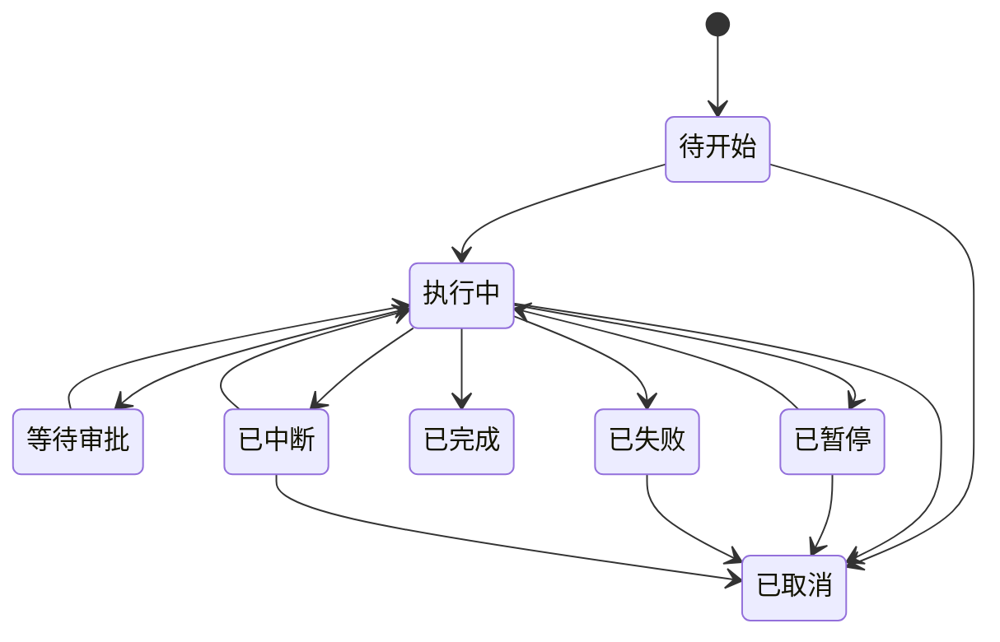

# Bowknot Agent 桌面端产品需求文档

| 项 | 内容 |
| --- | --- |
| 文档版本 | v0.1 |
| 状态 | 评审中 |
| 更新日期 | 2026-10-26 |
| 产品代号 | Bowknot Agent |
| 文档范围 | 产品需求；不含详细技术设计、接口定义与数据表结构 |

> 标记约定：`[TBD]` 表示尚未确定、需要决策的项；`[Assumption, TBD]` 表示当前按假设推进、后续需要确认；优先级 P0 > P1 > P2。

## 1. 背景与目标

### 1.1 背景

用户需要在同一个桌面工作空间中完成三类事情：使用第三方 Web 应用、让 AI 助手持续处理任务、生成图片/视频/语音。当前这些能力分散在不同网页与工具里，缺少统一入口、统一的模型配置和统一的任务视图。

### 1.2 产品定位

Bowknot Agent 是一个本地优先的桌面 AI 工作台，由四部分组成：应用商店与 WebApp 容器、助手与多 Agent 系统、创作工具、插件系统。所有 AI 能力通过可配置的 API 提供，由本地 AI 网关统一调度。

### 1.3 目标

- 用户可以在一个入口安装并启动 WebApp，且应用获得与其他应用一致的能力集。
- 用户可以向主 Agent 下达一个目标，并看到任务拆解、子 Agent 执行与协作、结果汇总的完整过程。
- 用户可以在同一界面生成图片、视频和语音，并在素材库中找回历史结果。
- 更换模型供应商只需修改配置，不需要改变产品流程。

## 2. 用户与核心场景

### 2.1 目标用户

单人本地用户，典型画像为开发者、创作者或重度 AI 使用者。

[Assumption, TBD] 产品为单机单用户，数据默认保存在本地，不提供账号体系与云同步。

### 2.2 核心场景

| 场景 | 入口 | 完成条件 |
| --- | --- | --- |
| S1 安装并使用远程 WebApp | 应用商店 | 应用在独立窗口正常运行，并获得与其他应用一致的能力集 |
| S2 主 Agent 完成多步任务 | 助手会话 | 用户看到任务拆解、子 Agent 执行与协作、最终汇总结果 |
| S3 通过桌宠与主 Agent 交互 | 桌宠窗口 / 全局唤起 | 桌宠完成一次文字或语音交互，并可跳转主界面 |
| S4 生成并管理素材 | 创作模块 | 生成结果成功落库，可在素材库检索与复用 |
| S5 配置模型供应商 | 设置 | 连接测试通过，对应能力可正常调用 |

## 3. 范围与优先级

- **P0**：首个可用版本必须完成的最小闭环，缺一项则该模块不可用。
- **P1**：核心闭环可用后补齐的增强能力。
- **P2**：明确暂缓，不进入当前版本范围。

| 模块 | P0 | P1 | P2 / 暂缓 |
| --- | --- | --- | --- |
| 桌面壳 | 主界面、模块导航、应用独立窗口、托盘 | 全局唤起、命令面板、通知、自启动 | — |
| App Store | 商店浏览、远程/本地安装、启动、卸载、开发者验证环境 | 更新、远程 URL 应用、应用管理 | — |
| 助手 / Agent | 主 Agent、子 Agent 管理、任务派发与汇报、子 Agent 协作通信、对话、运行限制、审批 | 运行追踪与断点重试、协作关系可视化 | — |
| 桌宠 | 窗口与占位形象、基础交互、TTS 表达 | 正式视觉形态、语音输入、空闲行为 | 写实人像形态 |
| 长期记忆 | 分层存储、写入策略、检索、管理、导出清除 | 冲突处理与版本选择 | — |
| 创作 | 图片生成、语音合成、任务队列、素材库 | 视频生成、费用预估 | — |
| AI 网关 | 供应商配置、能力路由、密钥安全、用量记录 | 预算与告警 | — |
| 授权与订阅 | 月度/年度授权、激活、到期降级、设备绑定 | 许可证门户、自动续费 | 买断制 |
| 任务中心 | 统一列表、详情、取消/重试、持久化 | 通知联动 | — |
| 隐私与数据 | 审计、数据管理 | — | — |
| 插件 | — | — | 全部（协议未定） |

## 4. 产品模型

### 4.1 角色与职责

| 角色 | 职责 | 边界 |
| --- | --- | --- |
| 本地用户 | 唯一的操作者与付费主体 | 拥有全部数据 |
| 主 Agent | 理解目标、拆解任务、派发、汇总、向用户汇报 | 仅一个，不可删除；所有对外结论由它给出 |
| 子 Agent | 执行单一任务并向主 Agent 汇报；可与其他子 Agent 直接沟通协作 | 不直接面向用户；不得改变任务目标或绕过主 Agent 汇总 |
| WebApp | 第三方或本地网页应用 | 运行在受限容器内，使用平台统一提供的能力集 |
| 插件 | 为 Agent 提供模型之外的工具能力 | 暂缓，独立进程运行 |
| AI 网关 | 唯一的模型 API 调用出口 | 不暴露给 WebApp 与渲染界面直接访问密钥 |

### 4.2 核心对象

| 对象 | 定义 | 关键属性 |
| --- | --- | --- |
| 应用清单 | WebApp 的安装与运行描述 | 应用 ID、名称、版本、入口、窗口参数 |
| 统一能力集 | 所有 WebApp 可获得的一组系统能力 | 能力项、调用边界、错误码 |
| Agent | 可配置的智能体 | 名称、人设、模型、工具、记忆范围、预算 |
| 任务 | 一次可跟踪的执行单元 | 目标、执行者、输入、状态、预算、产出物 |
| 汇报 | 子 Agent 返回给主 Agent 的结构化结果 | 结论、产出物、问题、消耗 |
| 协作消息 | 子 Agent 之间的一次请求、答复或交接 | 发送方、接收方、任务 ID、目的、内容摘要、消耗 |
| 记忆 | 可被检索的长期信息 | 层级、内容、来源、时间、置信度 |
| 生成任务 | 一次图片/视频/语音生成 | 参数、模型、状态、费用、结果文件 |
| 素材 | 已生成的可用文件 | 类型、参数、模型、来源任务、收藏状态 |
| 供应商配置 | 一个模型服务商的接入信息 | 名称、地址、密钥、可用模型 |

### 4.3 关键状态

任务状态：

- 终态为已完成、已取消；已失败可重试，重试生成新任务并关联原任务。
- 应用重启后，执行中的任务必须恢复为「已中断」，由用户决定继续或终止。
- 应用状态：未安装、安装中、已安装、运行中、更新中、已禁用、损坏。

## 5. 功能需求

### 5.1 桌面壳与全局交互

主界面由左侧模块导航（应用、助手、创作、设置）、顶部全局状态（网关状态、当前模型、用量入口）和主内容区组成。任务中心可从任意模块打开。

| ID | 需求 | 行为与规则 | 异常与边界 | 优先级 |
| --- | --- | --- | --- | --- |
| FR-SHELL-01 | 主界面结构 | 切换模块时保留各模块上次状态；顶部常驻网关在线/离线状态 | 网关离线时，依赖模型的功能禁用并说明原因 | P0 |
| FR-SHELL-02 | 应用独立窗口 | WebApp 默认在新窗口打开；记忆窗口尺寸与位置；主窗口单实例 | 窗口恢复失败时回到默认布局 | P0 |
| FR-SHELL-03 | 托盘与退出 | 托盘菜单提供打开主界面、显示桌宠、退出；关闭主窗口默认最小化到托盘 [Assumption, TBD] | 有运行中任务时退出需提示并确认 | P0 |
| FR-SHELL-04 | 全局唤起 | 全局快捷键 [TBD] 唤起助手输入框；命令面板可搜索应用、Agent、任务与生成入口 | 快捷键冲突时提示并允许修改 | P1 |
| FR-SHELL-05 | 通知 | 任务完成、失败、待审批、生成完成时通知，可跳转到对应详情 | 支持免打扰时段 | P1 |
| FR-SHELL-06 | 自启动 | 默认关闭，用户可开启 | 开启失败需说明系统限制 | P1 |

### 5.2 App Store 与 WebApp 容器

商店以列表 + 详情的方式呈现应用；WebApp 运行在独立窗口与独立会话中，通过统一能力桥访问系统能力。所有 WebApp 获得同一能力集，不做按应用的能力授权。能力接口由宿主注入，WebApp 直接调用，不提供独立 SDK 包。

| ID | 需求 | 行为与规则 | 异常与边界 | 优先级 |
| --- | --- | --- | --- | --- |
| FR-APP-01 | 商店浏览 | 支持分类、搜索、查看详情（名称、图标、版本、大小、来源、更新说明）；显示未安装/已安装/可更新 | 商店源不可达时展示本地已安装列表与重试入口 | P0 |
| FR-APP-02 | 远程安装 | 下载 → 校验完整性与签名 → 安装 → 标记已安装 | 下载失败、校验失败、磁盘不足时保持未安装并给出原因；取消安装清理临时文件 | P0 |
| FR-APP-03 | 本地安装 | 选择本地安装包（zip 或目录）→ 校验清单与版本兼容性 → 安装 | 清单缺失、版本不兼容、应用 ID 冲突时拒绝并说明 | P0 |
| FR-APP-04 | 应用清单 | 必需字段：应用 ID、名称、版本、图标、入口、窗口默认参数、最低壳版本、来源信息；完整字段格式 [TBD] | 清单字段缺失或格式非法时拒绝安装 | P0 |
| FR-APP-05 | 启动与隔离 | 新窗口加载应用；独立会话隔离；注入统一能力接口；能力调用失败返回结构化错误 | 加载超时或崩溃时显示错误页，可重新加载；连续崩溃 [TBD] 次后提示禁用 | P0 |
| FR-APP-06 | 统一能力集 | 所有应用均获得：应用私有目录读写、用户显式选择文件/目录的受限读写、剪贴板、系统通知、打开外部链接 | 不提供原始文件系统访问；路径必须限制在允许的根目录内 | P0 |
| FR-APP-07 | 卸载 | 确认 → 关闭窗口 → 询问保留或删除应用数据 → 移除程序 | 保留的数据在数据管理中可见并可后续删除 | P0 |
| FR-APP-08 | 崩溃隔离 | 单个 WebApp 崩溃不影响壳与其他应用 | 崩溃计数与禁用策略 [TBD] | P0 |
| FR-APP-09 | 更新 | 启动时或手动检查更新；应用运行中不强制更新；更新失败回滚旧版本 | 需应用关闭后才能替换文件时给出明确提示 | P1 |
| FR-APP-10 | 远程 URL 应用 | 直接加载远程地址时显示域名；与其他应用获得同一能力集 [Assumption, TBD] | 地址不可达或证书异常时展示错误页，不提供跳过选项 | P1 |
| FR-APP-11 | 应用管理 | 已安装列表、启用/禁用、查看数据占用、打开数据目录 | 禁用后不删除数据 | P1 |
| FR-APP-12 | 开发者验证环境 | 主应用内提供开发者模式，默认关闭：加载本地应用目录、文件变更自动重载、打开 DevTools、注入真实能力、展示能力调用日志 | 本地目录必须包含合法清单；应用 ID 与已安装应用冲突时拒绝加载；开发应用使用独立数据空间并带明确标识；关闭开发者模式后不再运行本地目录应用 | P0 |

### 5.3 助手与多 Agent

助手模块分为三栏：Agent 列表、会话与输入、任务与运行详情。主 Agent 是用户唯一入口，负责任务拆解、派发、预算控制与最终汇总；子 Agent 之间可以直接沟通协作（参考 Grok Bot 的多 Agent 协作方式 [Assumption, TBD]），但用户可见的结论仍由主 Agent 给出。

| ID | 需求 | 行为与规则 | 异常与边界 | 优先级 |
| --- | --- | --- | --- | --- |
| FR-AGT-01 | 主 Agent 唯一性 | 系统内仅一个主 Agent，不可删除；可编辑人设、模型、工具、记忆范围 | 子 Agent 不能替代主 Agent 接收用户任务 | P0 |
| FR-AGT-02 | Agent 管理 | 创建、编辑、停用、删除子 Agent；字段包含名称、头像、人设、模型、可用工具、记忆范围、预算 | 删除有运行中任务的 Agent 时，必须先取消或转移任务 | P0 |
| FR-AGT-03 | 对话 | 流式输出；展示工具调用与结果摘要；支持中止、重新生成、引用记忆 | 模型失败时按备用顺序重试；网络中断保留已生成内容并可继续 | P0 |
| FR-AGT-04 | 任务派发 | 主 Agent 将目标拆为任务，指定执行者、输入、完成标准、预算 [Assumption, TBD] | 超出并发限制时排队，不静默丢弃 | P0 |
| FR-AGT-05 | 汇报与汇总 | 子 Agent 向主 Agent 提交结构化汇报（结论、产出物、执行摘要、未解决问题、消耗），并可向协作中的其他子 Agent 提供结论或产出物引用；主 Agent 汇总后向用户输出 | 子 Agent 失败时主 Agent 必须说明失败原因与影响 | P0 |
| FR-AGT-06 | 通信拓扑与协作 | 允许主↔子、子↔子通信；子 Agent 可发起询问、确认接口、交接产物、协同拆分；所有通信必须绑定任务 ID 并进入任务追踪 | 子 Agent 不得自行创建或取消任务、不得修改目标与预算，需要变更时向主 Agent 申请；跨任务或跨记忆范围通信需主 Agent 授权 [Assumption, TBD] | P0 |
| FR-AGT-07 | 运行限制 | 最大任务深度、并发数、单任务步数、费用预算、超时均可配置，默认值 [TBD] | 触达任一限制时任务暂停并请求用户决定继续或终止 | P0 |
| FR-AGT-08 | 高风险审批 | 写文件、删除、发消息、付费或调用高成本模型、安装插件需用户确认 | 未批准时不执行，Agent 收到拒绝并调整方案 | P0 |
| FR-AGT-09 | 运行追踪 | 每次运行可查看步骤、工具调用、耗时、费用与错误 | 支持从失败步骤重试 | P1 |
| FR-AGT-10 | 取消与恢复 | 用户可暂停或取消；取消后保留已产生产出物与费用记录 | 重启后未完成任务恢复为已中断 | P0 |
| FR-AGT-11 | 协作限制 | 单任务内的协作消息轮次、通信深度、并发协作会话数、协作费用均纳入任务预算，默认值 [TBD] | 超限时中断协作并让相关子 Agent 向主 Agent 回报失败；禁止子 Agent 间无限互相等待，超时必须返回或失败 | P0 |
| FR-AGT-12 | 协作视图 | 任务详情展示参与 Agent、消息流、每次通信的目的、耗时与消耗，可展开内容摘要 | 用户可中止单条协作或整个协作组；中止后相关子 Agent 收到终止信号并回报主 Agent | P0 |

### 5.4 桌宠

桌宠是常驻的轻量交互入口，承载主 Agent 的人设与语音表达。原型阶段使用占位形象，只验证窗口、交互与语音链路。

| ID | 需求 | 行为与规则 | 异常与边界 | 优先级 |
| --- | --- | --- | --- | --- |
| FR-PET-01 | 窗口 | 透明、置顶、可拖动、可隐藏；提供点击穿透开关；记忆位置与大小 | 多显示器与分辨率变化 [TBD] | P0 |
| FR-PET-02 | 占位形态 | 原型与 P0 使用占位形象；正式视觉形态 [TBD]（2D/3D/写实） | 形象资源缺失时显示占位图，不阻塞功能 | P0 |
| FR-PET-03 | 基础交互 | 点击唤出对话气泡与快捷菜单（聊天、静音、打开主界面、隐藏） | 无可用模型时提示配置，不进入无限等待 | P0 |
| FR-PET-04 | 语音表达 | 文本回复经 TTS 播放；具备基础口型或表情反馈；字幕可开关；语音、语速、音量可配置 | TTS 失败时降级为文字并提示 | P0 |
| FR-PET-05 | 人设一致性 | 桌宠与主 Agent 共用 persona 与长期记忆；称呼与语气一致 | 用户修改人设后需在下次回复生效 | P0 |
| FR-PET-06 | 隐私边界 | 默认不常驻监听；录音时有明确指示；支持一键静音与关闭 | 无麦克风权限时降级为文字 | P0 |
| FR-PET-07 | 语音输入 | 提供按键说话；唤醒词为可选项，开启前需明确提示 | 识别失败可重试，不自动上传无关音频 | P1 |
| FR-PET-08 | 空闲与打扰 | 空闲时低帧率待机；全屏应用或会议时自动静音或隐藏 [Assumption, TBD]；支持免打扰时段 | 用户手动隐藏后不自动弹出 | P1 |

### 5.5 长期记忆

| ID | 需求 | 行为与规则 | 异常与边界 | 优先级 |
| --- | --- | --- | --- | --- |
| FR-MEM-01 | 分层 | 工作记忆（当前会话）、情景记忆（历史事件与任务）、语义记忆（事实与偏好）、用户画像 | 层级对用户可见，可分别管理 | P0 |
| FR-MEM-02 | 写入策略 | 用户明确要求记住、用户纠正、任务结论、稳定偏好可写入；闲聊默认不写入；是否需确认 [Assumption, TBD] | 低置信度信息不得直接作为事实写入 | P0 |
| FR-MEM-03 | 检索 | 对话按语义与时间检索相关记忆；引用时在界面标注来源 | 无相关记忆时不编造，明确表示未找到 | P0 |
| FR-MEM-04 | 管理 | 查看、编辑、删除；按全局或 Agent 范围筛选；支持搜索 | 删除需二次确认 | P0 |
| FR-MEM-05 | 导出与清除 | 导出为可读文件；清除全部记忆需二次确认 | 清除后不可恢复 | P0 |
| FR-MEM-06 | 隐私 | 默认本地存储；生成 embedding 时仅传输必要文本；供应商与用途在隐私中心可见 | 供应商不支持时不启用语义检索，降级为关键词 | P0 |
| FR-MEM-07 | 冲突处理 | 同一主题多版本时保留最新版本并标注被替代内容；用户可手动选择生效版本 | 用户纠正优先于系统推断 | P1 |

### 5.6 创作模块

创作模块分为图片、视频、语音三个标签，每个标签包含参数区与结果区，生成任务统一进入任务中心。

| ID | 需求 | 行为与规则 | 异常与边界 | 优先级 |
| --- | --- | --- | --- | --- |
| FR-CRE-01 | 图片生成 | 输入提示词、反向提示词（模型支持时）、尺寸、数量、模型；提交后进入队列并展示进度 | 参数超出模型能力时禁用并说明 | P0 |
| FR-CRE-02 | 语音合成 | 输入文本，选择音色、语速、音量、格式；支持试听与保存到素材库 | 长文本分段策略 [TBD]；超长文本需提示 | P0 |
| FR-CRE-03 | 生成任务 | 状态与任务中心一致；支持取消与重试；重启后状态可恢复 | 重试不得重复计费，需网关幂等支持 [TBD] | P0 |
| FR-CRE-04 | 素材库 | 记录参数、模型、时间、费用、来源任务；支持收藏、删除、打开文件位置、按类型筛选 | 存储配额与清理策略 [TBD]；删除不可恢复需确认 | P0 |
| FR-CRE-05 | 失败处理 | 区分供应商错误、内容审核拒绝、超时、配额不足，并给出明确原因 | 内容审核拒绝不自动重试 | P0 |
| FR-CRE-06 | 视频生成 | 文生视频、图生视频；时长、分辨率、帧率受模型约束；展示进度与预估等待 [TBD] | 长任务中断后保留参数，可重新提交 | P1 |
| FR-CRE-07 | 费用提示 | 提交前显示预估费用；超过单次阈值需确认，阈值 [TBD] | 无法预估时提示可能产生费用 | P1 |
| FR-CRE-08 | 能力适配 | 根据所选模型动态启用或禁用参数；不支持的参数不提交 | 未配置对应能力时隐藏入口并引导配置 | P0 |

### 5.7 插件管理（P2，暂缓）

| ID | 需求 | 行为与规则 | 异常与边界 | 优先级 |
| --- | --- | --- | --- | --- |
| FR-PLG-01 | 安装与清单 | 本地或远程安装；清单包含 ID、版本、权限、工具定义 | 清单校验失败拒绝安装 | P2 |
| FR-PLG-02 | 分配 | 可为每个 Agent 启用或禁用插件与工具 | 插件停用后相关工具调用立即失效 | P2 |
| FR-PLG-03 | 隔离与限制 | 独立进程运行；超时、输出大小、网络访问受限 | 进程崩溃不影响主程序 | P2 |
| FR-PLG-04 | 审批与审计 | 高风险工具调用需确认，调用记录可查 | 审计记录不可由插件修改 | P2 |
| FR-PLG-05 | 协议 | 是否兼容 MCP [TBD] | 未定前不开放第三方插件 | P2 |

### 5.8 AI 网关与模型配置

| ID | 需求 | 行为与规则 | 异常与边界 | 优先级 |
| --- | --- | --- | --- | --- |
| FR-GW-01 | 供应商配置 | 新增、编辑、删除；字段包含名称、类型、地址、密钥、可用模型；提供连接测试 | 测试失败保留配置但标记不可用 | P0 |
| FR-GW-02 | 能力路由 | 对话、图片、视频、语音合成、语音识别、embedding 可分别指定模型与备用顺序 | 未配置的能力在对应模块中禁用 | P0 |
| FR-GW-03 | 密钥安全 | 密钥仅存储在网关侧并加密；界面只显示掩码；日志不记录明文 | 密钥缺失或失效时提示重新配置 | P0 |
| FR-GW-04 | 本地 / 远程 | 网关可调用云端服务或本地服务 | 本地服务不可用时按备用顺序切换 | P0 |
| FR-GW-05 | 稳定性 | 流式输出、超时、重试、限流；错误按鉴权、配额、网络、内容审核、服务端分类 | 重试次数 [TBD]；内容审核错误不重试 | P0 |
| FR-GW-06 | 用量记录 | 每次调用记录供应商、模型、能力、token 或时长、费用估算，并关联任务 | 无法获取用量时标记为估算 | P0 |
| FR-GW-07 | 离线状态 | 网关不可用时顶部提示；浏览本地应用、查看历史、编辑配置可用 | 对话、生成与语义检索禁用并说明 | P0 |
| FR-GW-08 | 访问安全 | 仅监听本机回环地址并校验本地令牌 | 不接受外部网络连接 | P0 |

### 5.9 任务中心

| ID | 需求 | 行为与规则 | 异常与边界 | 优先级 |
| --- | --- | --- | --- | --- |
| FR-TASK-01 | 统一列表 | 展示 Agent 任务与生成任务；包含状态、发起方、时间、费用 | 支持按状态与模块筛选 | P0 |
| FR-TASK-02 | 详情与操作 | 查看步骤、产出物、日志；暂停、继续、取消、重试；处理审批 | 终态任务不提供继续操作 | P0 |
| FR-TASK-03 | 持久化 | 应用重启后恢复任务；执行中的任务标记为已中断 | 恢复失败时保留记录并允许查看 | P0 |
| FR-TASK-04 | 通知 | 完成、失败、待审批时通知并可跳转 | 免打扰时不发声，仅保留列表标记 | P1 |

### 5.10 隐私与数据中心

| ID | 需求 | 行为与规则 | 异常与边界 | 优先级 |
| --- | --- | --- | --- | --- |
| FR-PRIV-01 | 审计记录 | 记录安装、卸载、敏感能力调用、插件执行；保留时长 [TBD] | 用户可查看与导出 | P0 |
| FR-PRIV-02 | 数据管理 | 区分应用数据、记忆、素材、日志；显示位置与占用；支持导出与清除 | 清除需二次确认 | P0 |

### 5.11 用量与费用

| ID | 需求 | 行为与规则 | 异常与边界 | 优先级 |
| --- | --- | --- | --- | --- |
| FR-COST-01 | 用量面板 | 按时间、模块、供应商、模型统计调用与估算费用 | 估算值与供应商账单存在差异时注明 | P1 |
| FR-COST-02 | 预算与告警 | 可设置每日或每月预算与告警阈值；超限策略为仅提醒或阻止 [TBD] | 超限阻止后，运行中任务暂停并提示 | P1 |

### 5.12 授权与订阅

产品采用月度或年度订阅授权，不提供买断。核心原则：到期只降级、不删除数据。

| ID | 需求 | 行为与规则 | 异常与边界 | 优先级 |
| --- | --- | --- | --- | --- |
| FR-LIC-01 | 授权类型 | 提供月度与年度两档，功能一致、仅时长不同；年度为默认推荐 | 不提供买断；促销不改变授权规则 | P0 |
| FR-LIC-02 | 激活 | 输入授权码 → 服务端校验 → 绑定安装 ID（设备上限 [TBD]）→ 下发签名许可证 | 授权码无效、已使用、已过期、超出设备数时拒绝并说明原因 | P0 |
| FR-LIC-03 | 有效期与续费 | 显示到期时间；续费时长叠加到当前到期时间；到期前 [TBD] 天提醒 | 续费失败保留原到期时间，不清空授权 | P0 |
| FR-LIC-04 | 到期降级 | 到期后降级为免费版，Pro 功能禁用但数据保留，可导出 | 不得删除或锁定用户的记忆、素材与应用数据 | P0 |
| FR-LIC-05 | 设备管理 | 查看已绑定设备，支持解绑与换机；解绑次数限制 [TBD] | 超过次数需人工处理 | P1 |
| FR-LIC-06 | 离线校验 | 许可证本地缓存；离线宽限期 [TBD] 天；定期联网校验 | 本地时间异常不延长授权；校验失败按宽限期处理 | P0 |
| FR-LIC-07 | 授权门户 | 通过邮箱找回授权码、查看续费记录与发票 [TBD] | 不做完整账号体系，仅收集必要信息 | P1 |
| FR-LIC-08 | 撤销与退款 | 服务端可撤销授权，客户端在下次校验时生效 | 退款政策 [TBD]；撤销不删除已产生的数据 | P1 |
| FR-LIC-09 | 功能分级 | 免费版与 Pro 的能力清单在产品内可见；未授权功能显示升级入口 | 升级提示不阻断当前任务 | P0 |
| FR-LIC-10 | 防篡改 | 许可证必须验签；关键云端能力由服务端鉴权 | 不依赖客户端时间；本地篡改只影响本机 | P0 |

## 6. 共享规则与异常

### 6.1 能力模型

- 所有 WebApp 获得同一能力集，安装后即可调用，不做按应用授权与运行时确认。
- 能力集包含：应用私有目录读写、用户显式选择的文件/目录的受限读写、剪贴板、系统通知、打开外部链接。
- 能力是受限接口：不暴露原始文件系统；路径限制在允许的根目录内；访问用户文件必须由用户在选择器中显式选择。
- 安装第三方应用即视为信任其拥有统一能力集，用户应只安装可信来源的应用。
- 能力调用失败必须返回结构化错误，不允许静默降级。

### 6.2 数据保留

| 数据类型 | 存储位置 | 保留规则 | 删除方式 |
| --- | --- | --- | --- |
| 应用数据 | 应用私有目录 | 卸载时由用户选择保留或删除 | 数据管理或卸载 |
| 记忆 | 本地 | 直到用户删除或替换 | 记忆管理，二次确认 |
| 素材 | 本地 | 配额 [TBD] | 素材库删除，不可恢复 |
| 日志与审计 | 本地 | 保留 [TBD] 天 | 数据管理 |
| 授权信息 | 本地 + 授权服务 | 到期后保留记录 [TBD] | 用户申请删除 |

### 6.3 任务与失败

- 任务只能由用户或主 Agent创建；子 Agent 不得自行创建跨任务任务。
- 子 Agent 间通信必须携带任务 ID 与目的，并进入任务追踪；跨任务或跨记忆范围通信需主 Agent 授权。
- 协作消息计入任务预算；超过轮次或深度限制时中断协作，并由相关子 Agent 回报主 Agent。
- 终态后不再变更；重试创建新任务并关联原任务。
- 失败分类：模型错误、网络错误、内容审核、配额不足、工具失败、超时。重试次数 [TBD]；内容审核失败不重试。
- 取消后保留已产生的产出物与费用记录，并明确标注。
- 高风险工具在审批前不得执行；审批超时按拒绝处理。

### 6.4 审计

- 必须记录：安装与卸载、敏感能力调用、插件执行、模型配置变更。
- 默认不记录用户输入与生成内容的完整正文 [TBD]，以降低隐私风险。
- 审计记录对用户可见、可导出，且不可由应用或插件修改。

### 6.5 离线与降级

- 网关离线时，浏览本地应用、查看历史、编辑配置可用；对话、生成、语义检索禁用。
- 单个供应商故障时按备用顺序切换；全部失败则任务失败并提示。
- 无网络时仅本地安装可用。

### 6.6 授权与降级

- 授权服务是唯一允许的云端依赖；不可用时使用本地缓存的签名许可证。
- 离线宽限期 [TBD] 天；超过宽限期后降级为免费版，但不删除任何用户数据。
- 到期后 Pro 功能禁用，记忆、素材与应用数据仍可查看、导出。
- 续费时长叠加，不重置剩余时长。
- 许可证必须验签，校验不依赖客户端时间。

## 7. 非功能需求

| 类别 | 要求 |
| --- | --- |
| 启动与响应 | 主界面可交互前显示加载状态；模块切换不出现明显卡顿；具体时延目标 [TBD] |
| 资源占用 | 桌宠空闲时降低刷新率；后台任务不得导致界面无响应；具体阈值 [TBD] |
| 稳定性 | 单个 WebApp、插件进程崩溃不得导致主程序退出；任务状态可恢复 |
| 安全 | 安装即获得统一能力集，安装包必须校验；密钥加密且不进入界面进程；网关仅本机访问 |
| 隐私 | 数据本地优先；录音、截图、文件访问有明确指示；支持导出与彻底删除 |
| 可恢复性 | 任务、窗口、配置在重启后恢复；失败操作可重试 |
| 可观测性 | 提供本地日志与任务追踪；日志不包含密钥与敏感正文 |
| 更新 | 壳、商店、应用与插件均有版本检查与失败回滚策略 |
| 国际化与主题 | P2 预留，具体语言与主题 [TBD] |
| 可访问性 | 键盘可达性与高对比度 [TBD] |

## 8. 技术约束与原型边界

### 8.1 已确认约束

- 目标平台为 macOS 与 Windows 双平台，不支持 Linux；两平台的打包、签名与分发需分别适配（macOS 需签名与公证，Windows 需代码签名）。
- 不使用 Electron。
- 桌面壳技术栈：`mygo`（已确定，官方文档 `https://mygo.egoist.dev/docs`）。
- 除 WebApp 窗口外，主界面、助手、创作、设置、桌宠等所有界面均使用 mygo 原生 UI（Go + `ui` 包）；WebApp 窗口使用系统 webview 加载网页。
- 原生 UI 项目需要 Go 1.27 或更高版本，不依赖 Bun；仅在需要自建 Web 前端时使用 Bun。
- 原型阶段使用 HTML + CSS + JavaScript 与模拟数据，只验证信息架构与交互；正式界面按 mygo 原生 UI 重写，原型代码不作为实现基础。
- 所有 AI 能力通过 API 提供，经本地 AI 网关统一出口，可配置云端或本地服务。
- 数据本地优先。
- 所有 WebApp 使用同一能力集，不做按应用的能力授权。
- 能力接口由宿主直接注入，WebApp 直接调用，不提供独立 SDK 包。
- 开发者验证环境采用主应用内开发者模式，默认关闭；不单独发布 Dev 构建。
- 采用月度/年度订阅授权，不做买断；授权服务是唯一允许的云端依赖。
- 插件体系暂缓，协议是否采用 MCP 未定。
- 桌宠在原型阶段使用占位形象。

### 8.2 mygo 能力验证项

以下能力直接决定四个模块能否落地，需在 `mygo` 上逐项验证，并在 macOS 与 Windows 两个平台分别验证：

- 原生 UI 覆盖导航、列表、表格、表单、弹窗、通知、菜单与托盘。
- 同一应用可同时包含原生 UI 窗口与 WebApp webview 窗口。
- WebApp 本地安装包可通过自定义协议加载，不依赖外部浏览器。
- 独立 WebApp 窗口、会话隔离与崩溃隔离。
- 向 WebApp 注入统一受限能力集（文件、剪贴板、通知等），且只能通过能力接口访问。
- 开发模式可加载本地应用目录、文件变更自动重载、打开 DevTools，并注入真实能力。
- 开发模式默认关闭，开启后加载的本地应用有明确标识，且与商店应用数据隔离。
- 透明置顶桌宠窗口与点击穿透。
- 多窗口状态恢复、全局快捷键、托盘。
- 与本地网关进程通信。
- 两平台的差异项（托盘、全局快捷键、自启动、窗口透明与点击穿透、webview 行为）需分别验证；是否 Windows 优先 [TBD]。

### 8.3 原型边界

- 不实现真实安装、能力调用与文件注入、模型调用。
- 使用模拟数据覆盖：商店列表、Agent 会话、任务派发与汇报、生成任务、用量。
- 至少覆盖空状态、失败状态与待审批状态。
- 原型用于确认布局、信息层级与交互流程，不作为技术可行性结论。
- 原型中的 HTML/CSS 不复用到正式工程；正式界面使用 mygo 原生 UI。

## 9. 暂缓与不做

- 插件系统全部功能，待协议确定后再评估。
- 写实人像桌宠，待技术验证后再决定。
- 完整账号体系、多用户、团队协作与云同步（默认不做）；仅保留最小授权服务与邮箱许可证门户。
- 移动端与 Web 端。
- 应用商店商业化与分成。
- 自研模型训练与微调。

## 10. 开放问题

| 编号 | 问题 | 影响 | 当前倾向 |
| --- | --- | --- | --- |
| Q-01 | `mygo` 对 8.2 关键能力的支持程度 | 决定能力注入、透明窗口、多窗口能否按需求实现 | 按 8.2 逐项验证，缺口给出替代方案 |
| Q-02 | 桌宠视觉形态与驱动方案 | 影响成本、周期与体验 | 先占位，2D 起步 |
| Q-03 | 插件协议是否采用 MCP | 影响插件生态与开发成本 | 暂缓 |
| Q-04 | 目标平台范围 | 影响打包与平台适配 | 已确认 macOS 与 Windows 双平台； |
| Q-05 | 是否允许远程 URL 应用 | 远程页面与本地应用共享同一能力集，安全风险最高 | 不允许          |
| Q-06 | 是否支持本地模型推理 | 影响网关设计与硬件要求 | [TBD] |
| Q-07 | 并发数、任务深度、协作轮次、预算、配额、日志保留等数值 | 影响成本控制与体验 | 待压测后确定 |
| Q-08 | 是否引入账号与云同步 | 影响数据模型与隐私方案 | 默认不做 |
| Q-09 | 内容安全与审核责任边界 | 影响创作模块与供应商选择 | [TBD] |
| Q-10 | 桌宠人设边界与语音常驻策略 | 影响隐私提示与产品预期 | 明确提示，不默认监听 |
| Q-11 | 多语言与主题范围 | 影响界面与文案体系 | P2 |
| Q-12 | 子 Agent 协作拓扑：是否允许临时协作组与组内广播、是否共享上下文 | 影响调度复杂度、成本与界面呈现 | 先支持点对点，协作组按需评估 |
| Q-13 | 定价、试用时长、续费方式（手动续费码 / 自动续费）与设备上限 | 影响支付接入、授权服务与用户体验 | 月/年双档，年付为主；先手动续费 |
| Q-14 | 开发者验证环境的形态 | 影响发布安全、开发体验与维护成本 | 已确认：主应用内开发者模式，默认关闭 |

## 11. 术语

| 术语 | 定义 |
| --- | --- |
| WebApp | 以网页技术实现、由本产品安装并运行的应用 |
| 能力注入 | 向 WebApp 暴露统一的能力接口，所有应用使用同一能力集 |
| 主 Agent | 唯一的调度者，负责任务拆解、派发与汇总 |
| 子 Agent | 由主 Agent 指派、执行单一任务并汇报的智能体 |
| 汇报 | 子 Agent 返回给主 Agent 的结构化执行结果 |
| 协作消息 | 子 Agent 之间为完成同一任务而发送的请求、答复或交接 |
| 本地 AI 网关 | 统一管理供应商、密钥、调用与用量的本地服务 |
| 素材库 | 保存生成结果及其参数、费用与来源的任务产出集合 |
| 插件 | 为 Agent 提供额外工具能力的独立组件 |
| 授权码 | 用于兑换月度或年度订阅时长的凭证 |
| 许可证 | 服务端签发的授权文件，包含有效期与绑定设备信息 |
